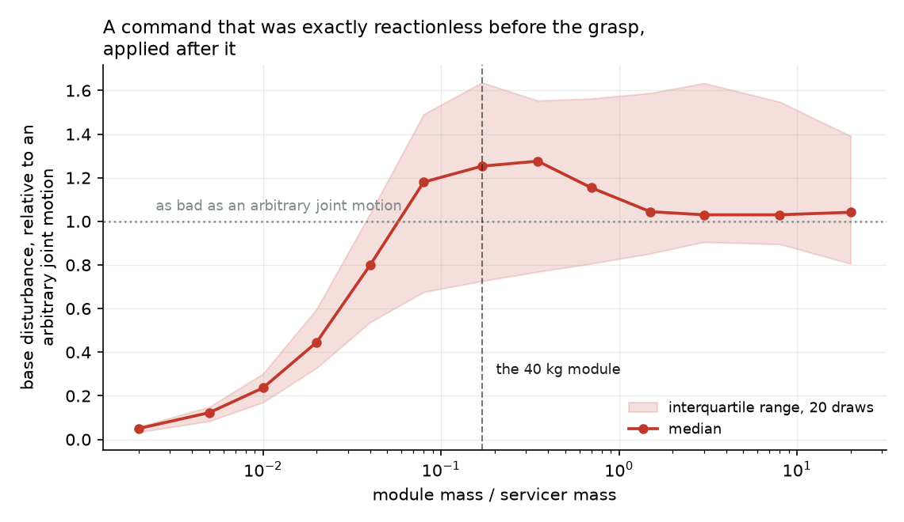

# dual-arm-closed-chain

Two arms on a free-flying servicer berthing a station module, where closing the
second gripper turns the system from a tree into a closed kinematic loop and
every object built for the one-armed case stops describing it. In-space
assembly is the driving case; the repository is named for the claim because
that is what makes the problem different.

The bus carries mass and inertia and no geometry, because it is a radius of
gyration rather than a shape. The translucent box above is a proxy drawn for
this picture only and takes no part in any measurement.

**Every figure here is drawn from a quantity the test suite asserts**, so a
figure cannot silently disagree with the text around it. Where a figure and a
test disagree, the test is right and the figure is stale. One of the three
figures below found a defect in a result this project had already published,
which is recorded under Bugs rather than quietly fixed.

## What is here

**The claim.** A servicer with one arm is a tree, and stays a tree. Two arms
berthing a module is a tree until the second gripper closes and a closed
kinematic loop afterwards. Every object Project C built assumes a tree, and the
task this project exists to perform is defined by crossing out of that
assumption, at the instant the task succeeds.

The assumption is not implicit. The mass matrix is built as a sum over
per-link centre of mass Jacobians whose columns are set by ancestry, and
ancestry is a tree concept. Close a loop and a link's motion is no longer
determined by its ancestors alone, so `H_b`, `H_bm`, the generalized Jacobian
`J_g` and the momentum-conservation argument underneath all of them are
computed on a model that no longer describes the system.

**A generated two-arm model.** Two Panda chains, name-prefixed per arm, on a
free-floating bus. Two Pandas rather than a bespoke servicer arm is deliberate:
it reuses Franka's published identified inertial parameters, which Project C
verified against PyBullet's free-base mass matrix to 5.7e-09 and against an
independent C++ implementation to 3.553e-15. A bespoke arm would mean new
inertial parameters with no independent check.

Nothing may be measured before the model is asserted, so seven properties are
checked on every generation: that it parses as a URDF, that both arms are
reachable from the bus under names shared with neither, that total declared
mass is the bus plus one arm per arm, that every inertia tensor survives
composition with its off-diagonal terms intact, that every joint keeps its own
limits, that **a consumer builds the inertia the file declares**, and that the
grasp pose sits inside every joint limit. The sixth exists because PyBullet
ignores declared inertia by default and built the bus with 0.00013 kg m^2
against the 50.0 declared, wrong by a factor of 375,000, silently, past five
checks that only read the file.

**Grasp geometry, and which of it is derived.** The gripper opens 0.0800 m and
the module is 0.4000 m across, so the grasp is on fixtures at the module's
faces rather than on the module. That is load bearing twice: hand separation at
grasp is `0.4000 + 2 x 0.1142 = 0.6285 m`, which sets the mount spacing at
+/- 0.8000 m, and the loop closes through the fixtures, which sets the
constraint equations. The grasp height of 0.55 m and the fore-aft envelope are
**stated choices with no berthing port specification behind them**, and every
margin quoted here is conditional on them.

**Vendored dynamics, generalised to N chains.** `kinematics.py` and
`dynamics.py` are copied from Project C at commit `343e2152`, with a provenance
record naming every intentional deviation. `kinematics.py` needed no change at
all. `dynamics.py` needed less than expected: the per-link ancestor filtering
was already there, so the mass matrix and coupling inertia generalise nearly
for free, and the one real blocker was a method that walked a single chain.
The generalisation is held to Project C's committed numbers on Project C's own
single-arm model, and the assertion that carries it is the closed-loop base
rotation of 18.98 degrees, one scalar exercising the whole stack.

**A four-layer reference, built before the formulation it checks.** Momentum
conservation, the open-chain limit, a second solver, and constraint forces
doing no work. The second solver was meant to be PyBullet's and cannot be: it
does not hold this closure. What replaces it is the constrained solve written
twice, Lagrange multipliers against analytic projection, agreeing to 2.386e-14
relative.

## Results

### What the second arm buys

`H_bm` maps joint rates to base momentum. Its null space is the set of joint
motions that disturb the base not at all, and with one 7-DOF arm against a
6-DOF base that null space is one dimensional: a reactionless direction exists,
but nothing is left over to also satisfy a task. With two arms it is eight
dimensional.

Eight is not the number that matters. What matters is that **either hand has
all six task directions available while the base stays exactly still**, in 200
of 200 sampled configurations, against one of six for a single arm. That is the
difference between a reactionless direction existing and reactionless motion
being a constraint a berthing trajectory can be planned under.

`H_bm` was rank 6 in 300 of 300 samples for both models. Rank loss was hunted
rather than assumed away, by descent on the smallest singular value from many
starts inside the joint limits, because a uniform sample over a 14-dimensional
box would never land on a measure-zero set and reporting that it did not would
say nothing. Forty restarts of four hundred steps found none. The search drove
one arm from a sampled median of 2.15e-02 down to 5.26e-06, a factor of 4000,
and two arms from 2.11e-01 only to 3.35e-03, a factor of 63, so the two-arm
coupling is markedly harder to push toward singular. **Not reachable by this
search** is the claim, not that no such configuration exists.

A limitation with the eight: the image of the null space in the twelve
dimensional two-hand task space is eight dimensional, so both hands cannot be
commanded independently and reactionlessly at once. Six for one hand, or eight
of the twelve shared.

### What the grasp transition costs

Two questions, and only the second bears on a controller. Whether the plant
changes is arithmetic and always yes. Whether anything notices is the one worth
measuring: take a joint motion that is exactly reactionless on the pre-grasp
plant, verified to 2.3e-18, apply it to the post-grasp plant, and read the base
twist it now produces against what an arbitrary joint motion produces there.

Median over twenty draws from the eight-dimensional null space: 0.050 at a
mass ratio of 0.002, 0.236 at 0.01, 0.799 at 0.04, 1.180 at 0.08, 1.253 at
0.17, **1.276 at 0.35**, then 1.154 at 0.7, 1.044 at 1.5, and about 1.03 for
two further decades.

**The curve peaks and settles rather than saturating, and the worst case is a
moderate module rather than a heavy one.** The peak sits at a ratio of 0.35,
about 82 kg, where a pre-grasp reactionless command produces 28 per cent more
base disturbance than an arbitrary joint motion would. A module twenty times
the servicer's mass is *less* damaging in relative terms.

The reading is that a heavy enough module dominates the plant for every command
alike, so a pre-grasp command stops being specifically mis-aimed and becomes
merely uninformed, which an arbitrary command already was. At moderate ratios
it is actively pointed the wrong way: it was optimised to cancel a base
reaction the module has since changed, and cancelling the wrong thing is worse
than not trying.

Below a ratio of about 0.01, roughly two kilograms, the transition is a
perturbation. The 40 kg module this project carries sits at 0.17, close to the
peak: by `H_b` it is the 20 per cent perturbation it was chosen to be, and by
the measure a controller feels it dominates. The three measures disagree about
the same module.

### What the tree formulation returns when the loop closes

Registered as a prediction before any of this was built: that Project C's
`generalized_jacobian`, run on a closed loop, returns a plausible number rather
than raising. **It holds**, and it is the first silent failure in this
portfolio predicted in advance rather than found afterwards.

It does not raise. It returns a 6 by 14 tensor, every entry finite, rank 6,
with a norm of 2.8300 against the fixed-base `J_m`'s 2.8329. Right shape, full
rank, right order of magnitude: it survives every check a caller would make.

That it does not raise is a statement about error handling. What it is wrong by
is the useful claim. Measured against the composite plant over 24 admissible
unit joint rates with the 40 kg module, the **relative error is a median 22.3
per cent**, range 6.5 to 119.0, and the **direction is out by a median 11.4
degrees**, worst 64.85.

Twenty two per cent is the dangerous size: too large to be right, too small to
look wrong, and it reads as modelling error or integration slop rather than as
a bug. The direction error rules out the comfortable reading, since a pure
scale factor could be calibrated out of a controller and an 11 degree median
heading error cannot.

The whole discrepancy is in the base twist. `J_m` and `J_b` are geometry and
the closure does not touch them; what the tree formulation gets wrong is
`H_b^-1 H_bm`.

### Why the model stops being valid at the moment the task succeeds

The free-floating formulation assumes no external wrench. Contact injects one,
so the model is valid up to the instant the task succeeds and not through it.
The two regimes are measured separately and the boundary stated, rather than
integrating a trajectory across a discontinuity.

**Before contact.** Carrying the 40 kg module 0.40 m forward displaces the
servicer **50 mm**, against **21 mm** predicted on the pre-grasp plant: a
factor of **2.4**. The per-step error of 22.3 per cent compounds rather than
cancelling, because it is a systematic bias and not noise.

**These figures are a correction, and the earlier ones are withdrawn.** This
result was first published as 105.84 mm against 25.36 mm over a 0.50 m carry,
a factor of 4.2. Both numbers were contaminated. The original measurement was
reading a **solver posture flip rather than servicer drift**: each waypoint was
solved independently with the palm roll swept afresh, the winning roll changed
between neighbours, and the joint vector jumped 4.876 rad in a single step
against 0.11 either side, which integrated into about 56 mm of base motion
belonging to the inverse kinematics. Solving it continuously also showed that
**the 0.50 m carry was never continuously achievable**: across all twelve rolls
the longest reachable without a posture change is 0.40 m, and 0.50 m fails by
34.15 mm. The original run described a trajectory that does not exist.

**The boundary.** Before contact the base twist is set by momentum
conservation. After contact the module is fixed to the station, so it is set by
kinematics instead: the hands must stay on a body that no longer moves and the
arms push off it. These are different laws, not one law with a correction term,
and no interpolation between them is meaningful.

**After contact.** Base twist per unit joint rate over 24 random directions is
a median 0.0552 free floating against 0.5178 berthed, a ratio of **9.44x**
ranging 5.38 to 21.72. A controller carrying the free-floating model through
contact would be wrong about the base response by an order of magnitude, and
wrong in a way no single gain retunes, since the ratio varies fourfold across
directions.
